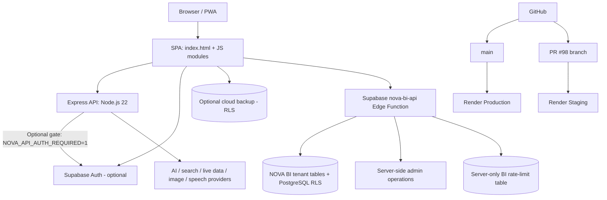

# NOVA AI — System Architecture

**Reviewed:** 12 November 2026. **Scope:** Source-derived architecture for PR #98, not a certification or a claim that this revision is deployed.

## System overview

## Components

| Layer | Files / service | Responsibilities | Boundary |
|---|---|---|---|
| Frontend | `index.html`, `nova-app.js`, `nova-entry.js`, `nova-reference.js`, mode registry/workspace | Bilingual shell, chat, navigation, PWA and browser workflows | Browser-local chat/settings are default; external CDN/media provenance is not fully cleared |
| Account | `nova-account.js` | Supabase sign-in and optional cloud backup | Cloud sync is opt-in/off by default; backup deletion is not Auth account deletion |
| API | `nova-server.txt`, `nova-server.js` | Static routes, health, chat, search, live retrieval, image jobs and transcription | Express auth gate defaults OFF; process-local rate windows are not durable quotas |
| Auth | `nova-api-auth.js` | Verifies Supabase bearer sessions server-side | Only enforced after `NOVA_API_AUTH_REQUIRED=1` and live verification |
| Provider controls | `nova-http.js`, `nova-provider-url.js`, `nova-rate-limit.js`, `nova-timezone.js` | HTTPS/redirect/body bounds, rate windows and timezone context | Does not establish vendor rights, hard spend caps or durable billing |
| NOVA BI | `nova-business*.js`, `supabase/functions/nova-bi-api` | CSV analysis, tenant metadata, approvals, audit and branding | Preview/synthetic-data only; risk output is heuristic and workflow actions are proposals |
| Database | Supabase PostgreSQL, migrations and RLS | Optional workspace sync and tenant data | Restore, deletion, retention and hosted two-account tests remain open |
| Delivery | GitHub Actions, Docker/Compose, Render | CI and deployment | CI success is not deployment/live proof |

## Main request flows

1. The browser loads the SPA and static modules from Express.
2. Public read-only configuration/feed requests use GET routes.
3. Chat, search, live data, image jobs and transcription pass through Express to configured providers; provider keys stay server-side.
4. Optional account login uses Supabase Auth; optional cloud sync uploads data only after explicit opt-in.
5. NOVA BI requests use the JWT-protected Supabase Edge Function. It derives the user from verified claims, applies database-backed per-user request limits, and relies on RLS for tenant boundaries.
6. GitHub Actions tests source, migrations/RLS, Deno, container and browser behavior. It cannot certify physical Android or live deployment.

## Runtime and known deployment configuration

- Node.js 22; start command: `node nova-server.txt`.
- Local: `npm ci`, copy `.env.example` to private `.env`, then `npm run start:local`.
- Dockerfile and Compose exist; exact PR CI built the image and ran container health smoke.
- Production: Render service `srv-dbidhpc9v7es73d6ia80`, https://novaai-4auo.onrender.com, branch `main`.
- Staging: Render service `srv-dbqm035g1s2s73eogao0`, https://novaai-pr98-staging.onrender.com, branch `fix/nova-home-learn-first-mobile-20261109`.
- At last check both were Free, Singapore, one instance; Health Check Path was blank. Production remained on commit `c3cee61906b88ff111b3a645db55c9c2503cd8f7`; Staging remained on old `195739a04895de364a5af22aa61f930d5d782cbb`.

## Missing production components

No stable versioned public API/OpenAPI contract, external SDK, webhook delivery/signature/retry system, or permissioned plugin framework. No durable Express user quotas, monthly usage ledger, plan entitlements or hard provider spend caps. No production subscription checkout, invoices, refund/cancellation/tax workflows. No complete account deletion/retention system. No proven monitoring/SLO, backup-restore drill or second-host deploy. Core app custom-domain white-label routing is not implemented.

**Release rule:** Keep PR #98 Draft/unmerged until current-head Staging, live security, provider rights, data lifecycle, physical Android, backup/restore and owner approval gates pass.

## NOVA BI source provenance

The local CSV import candidate calculates a SHA-256 digest from the uploaded file's bytes and attaches it to the analysis and portable Action Proof JSON bundle with the selected column mapping, row counts, calculation version and software-check results. The original CSV bytes are not embedded in the bundle. This is a reproducible file digest, not a digital signature, trusted timestamp, identity proof or guarantee against a compromised browser.
