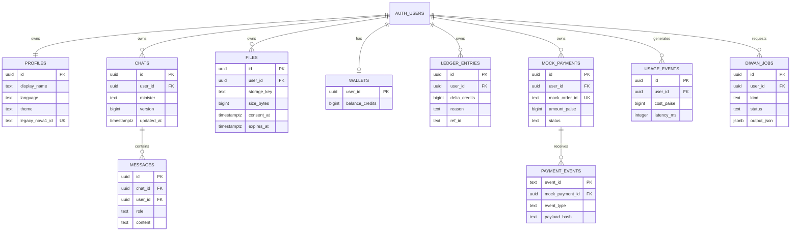

# NOVA 2.0 Data Model

**Status:** schema source is under supabase-v2/schema.sql. Timestamped migration is generated by Supabase CLI in the isolated workspace. It is not yet applied to a hosted project.

## Core entities
- Supabase Auth owns identities and sessions. The app never stores passwords or service-role keys.
- profiles holds preferences and an optional legacy identity mapping; no NOVA 1.0 user rows are copied.
- chats/messages are user-owned and protected by RLS. Messages have a composite (chat_id,user_id) foreign key in SQL to prevent cross-owner chat injection.
- files metadata points to private Storage objects. Uploads require explicit consent, owner-prefixed object keys and a maximum 24-hour expiry by default.
- wallets is a cached balance. ledger_entries is append-only; a database trigger applies each ledger delta transactionally. A negative balance is rejected by the database constraint.
- mock_payments and payment_events support synthetic test orders and idempotent webhook events only. No real gateway is enabled.
- usage_events records feature/model/token/cost/latency metadata; it must never contain prompts, documents, passwords or OTPs.
- diwan_jobs stores task state and validated outputs with expiry.
- schemes is an official-source-reviewed dataset; it currently contains zero approved records.
- audit_log and feature_flags are server-controlled. Clients receive no direct write grants.

## Data ownership and lifecycle
1. All user-owned rows use auth.uid() RLS ownership checks.
2. Ledger, wallet writes, mock payment state and audit records are server-only.
3. Cloud sync is off by default; local NOVA 1.0 keys remain untouched.
4. Temporary files expire after 24 hours unless a future owner-approved save action is implemented.
5. Account export and deletion are implemented as Edge Function source but are NOT VERIFIED until deployed and tested against the separate staging project.
6. Production tables, migrations, functions and user records remain untouched.
